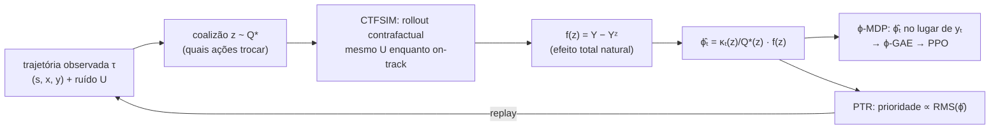
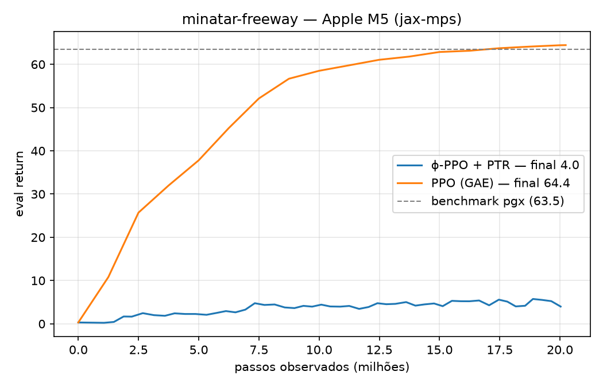
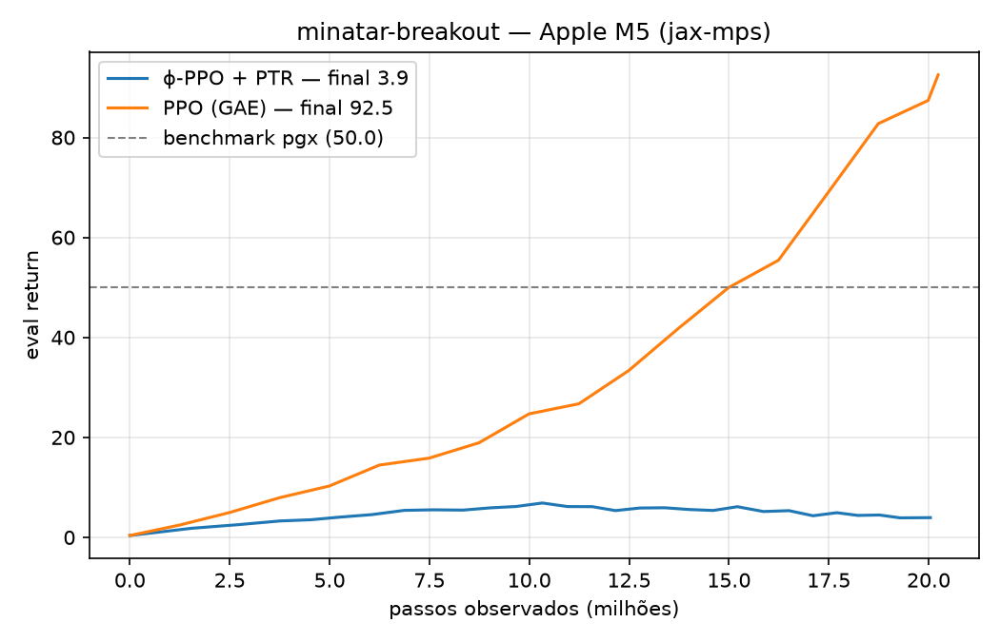
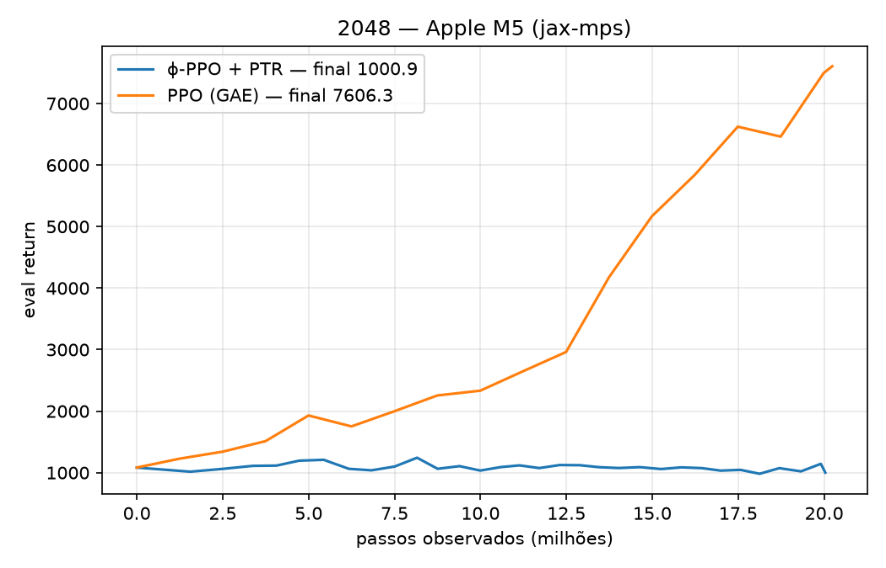

# Causal Credit Assignment — ϕ-PPO em MinAtar/Freeway

POC do artigo **Counterfactual Shapley Credit Assignment** (Li, Lee & Bareinboim,
RLJ 2026, [causalai.net/r148.pdf](https://causalai.net/r148.pdf)) num ambiente "de verdade":
`minatar-freeway` do [pgx](https://github.com/sotetsuk/pgx), treinando num Mac (Apple M5) com o
acelerador **MPS**.

A pergunta: **o ϕ-PPO (recompensas trocadas por valores de Shapley contrafactuais + Prioritized
Trajectory Replay) iguala o benchmark do PPO no Freeway (≈ 63.5 de eval return em 20M passos)?**

## A ideia do paper em uma figura

O crédito de cada ação é o seu **valor de Shapley contrafactual** ϕₜ: quanto o retorno observado
mudaria se a ação tivesse sido outra, *mantendo fixo todo o ruído exógeno* (a "sorte") da
trajetória observada.



Propriedades que o paper prova:
- o ϕ-MDP tem a **mesma política ótima** que o MDP original (Thm 3.7);
- Σₜ ϕₜ = Y − Y¹ (eficiência de Shapley);
- a variância cai quando há **causalidade esparsa**, **alta estocasticidade** e **recompensa
  atrasada** (Props 3.9–3.11).

## Por que o pgx encaixa no paper

| Requisito do paper | No pgx |
|---|---|
| simulador resetável | `State` é um pytree imutável: guardar ou copiar estado é de graça |
| ruído exógeno Uₜ independente por passo (Assumption 3.3) | `env.step(state, action, key)`: toda a aleatoriedade (sticky action 10% + velocidade dos carros) vem de `key`, então **`keyₜ` = Uₜ** |
| reusar (sₜ₊₁, yₜ) quando o contrafactual está on-track | reusar o mesmo `keyₜ`: o step é determinístico dado `(s, a, key)` |
| chunks que não atravessam episódios | episódios do Freeway duram **sempre 2501 = 41 × 61** passos, então chunks de **T = 61** ficam alinhados |

### CTFSIM (Algo 2) em uma figura

```
 t:        1      2       3       4       5
 z:        0      1       0       0       1        (1 = ação trocada pela baseline π)
 obs:     x1     x2      x3      x4      x5
 cf:      x1    x'~π    x3      x''~π   x'''~π
 estado:  on    on      off→on  off     off        sᶻₜ == sₜ ?  (fingerprint de 64 bits)
 key:     k1    k2*     k3      k4*     k5*        (* par (s,x) diferente → ruído novo)
```

- Enquanto `sᶻₜ == sₜ` e `zₜ = 0`, a ação observada é reusada. Fora disso, sorteia-se uma ação de π
  (self-baseline: π_base = π).
- Se o par (sᶻₜ, xᶻₜ) é igual ao observado, reusa-se `keyₜ`. Caso contrário, a chave é nova.
- A igualdade de estado é testada **a cada passo**, então o contrafactual pode voltar aos trilhos
  (Fig. 3 do paper).

## Estrutura

```
causal-credit-assignment/
├── train.py         # mesma estrutura do pgx/examples/minatar-ppo
├── agent.py         # rede ActorCritic (flax.nnx) + passo de avaliação (treino e render)
├── phi.py           # Q*, pesos de Shapley, CTFSIM, NTE λ-bootstrapped, ϕ-GAE
├── ptr.py           # buffer PTR em JAX: estado inicial + keys + ações (re-simulação)
├── plot.py          # curva eval return × passos observados (um gráfico por ambiente)
├── render.py        # re-simula e renderiza o melhor episódio de avaliação (GIF/MP4)
├── tests/test_phi.py
└── results/         # logs .jsonl + gráfico
```

`train.py` tem dois modos:
- `algo=ppo`: o PPO original (GAE nas recompensas do ambiente), usado como baseline;
- `algo=phi_ppo`: Algo 3 do apêndice. Em cada iteração:
  1. ξ ~ Beta(α+1, β+1) define a fração de chunks *fresh* e o resto vem do replay;
  2. rollout observado de T passos;
  3. M coalizões (+ complementos antitéticos) → ϕ̂;
  4. ϕ-GAE (γϕ = 1, λϕ = 0.95);
  5. prioridades (EMA de ϕ̂², Eq. 20), decay/eviction e IS weights (Eq. 18);
  6. a loss combinada `L_PTR + c1·L_Vψ + c2·L_Vϕ − c3·H` (Eq. 23).

A rede é um `nnx.Module` com o torso do exemplo do pgx e três cabeças: π, Vψ (MDP original,
usada no bootstrap dos contrafactuais) e Vϕ (ϕ-MDP).

## Como rodar

```sh
# na raiz do repo (uv workspace)
uv sync --package causal-credit-assignment

cd projects/2026/causal-credit-assignment
uv run --package causal-credit-assignment python train.py algo=ppo eval_every=5
uv run --package causal-credit-assignment python train.py algo=phi_ppo num_coalitions=4 nte_lambda=0.9 eval_every=10
uv run --package causal-credit-assignment python plot.py
uv run --package causal-credit-assignment pytest -q tests
```

Ambientes: `env_name=minatar-freeway|minatar-breakout|2048|...`. No 2048, as ações ilegais são
mascaradas e convém usar `reward_scale=0.01` (os merges valem até milhares de pontos).

Os parâmetros seguem o estilo do exemplo (`chave=valor`, via OmegaConf + pydantic). Use
`platform=cpu` para rodar sem GPU.

### Visualizar o melhor episódio

Com `save_best=true` (padrão), sempre que um eval bate o melhor retorno de episódio até então, o
treino salva só os `params`, a `key` do eval e o índice do episódio em `results/best/<run>.pkl`.
Isso acontece raramente e não custa nada no loop.

Como o eval é determinístico dado esses três itens, o `render.py` **re-simula** o episódio e
renderiza:

```sh
uv run --package causal-credit-assignment python render.py                  # .pkl mais recente
uv run --package causal-credit-assignment python render.py results/best/minatar-breakout-phi_ppo-seed0.pkl \
    --format mp4 --fps 30 --stride 2                                          # MP4 precisa de ffmpeg
```

- **MinAtar:** o pgx não anima MinAtar (`save_svg_animation` recusa explicitamente) e o
  `visualize_minatar` abre uma figura matplotlib por frame. Por isso os frames são desenhados direto
  com o colormap do `pgx-minatar`.
- **2048:** além do GIF, sai também o SVG animado oficial do pgx (`pgx.save_svg_animation`).
- O script confere se o retorno re-simulado bate com o salvo e avisa se não bater (por exemplo,
  quando o render roda em outra plataforma JAX que não a do treino).

### Compatibilidade no Mac (MPS)

- O `jax-metal` da Apple parou no jax 0.4.34.
- Aqui usamos o **[jax-mps](https://github.com/tillahoffmann/jax-mps)** 0.10.x (plugin PJRT sobre
  MLX), compatível com o `jax==0.10.1` / `flax==0.12.7` já fixados no repo, mais `pgx==2.6.0` e
  `pgx-minatar==0.5.1` (o MinAtar é uma extensão separada do pgx, com licença GPL-3).
- PPO no Freeway (4096 envs × 125 passos por iteração): **~8 s por iteração no MPS, contra
  ~158 s na CPU (≈ 20× mais rápido)**. A curva de aprendizado é equivalente nos dois backends.

> ⚠️ O venv é compartilhado pelo workspace. Com `jax-mps` instalado, o plugin fica ativo por
> padrão para os outros projetos do repo também. Use `JAX_PLATFORMS=cpu` para desligá-lo.

## Testes

`tests/test_phi.py` (CPU):
- o estimador com Q*, simples e antitético, é **não-viesado**: a esperança exata bate com o Shapley
  da Eq. 3 calculado por força bruta;
- a soma dos pesos reproduz a eficiência;
- os tamanhos sorteados seguem q*ₖ;
- CTFSIM com z = 0 reproduz exatamente a trajetória e o retorno (common random numbers);
- com λ = 1, o NTE por passo é igual ao NTE exato;
- episódios do Freeway terminam em múltiplos de 61;
- inserção, decay, eviction, IS weights e amostragem do buffer PTR.

## Resultados

Tudo rodado num Apple M5 (MPS), seed 0 e **20M passos observados** por rodada. O ϕ-PPO usa
M = 4 coalizões antitéticas (8 rollouts contrafactuais por chunk), λ = 0.9 e PTR completo.

| ambiente | benchmark pgx (PPO) | **PPO (nosso)** | **ϕ-PPO + PTR** | melhor média ϕ-PPO | tempo PPO / ϕ-PPO |
|---|---|---|---|---|---|
| Freeway | 63.5 | **64.4** | 4.0 | 5.7 | 5 min / 63 min |
| Breakout | ~50 | **92.5** | 3.9 | 6.9 | 5 min / 28 min |
| 2048 | — | **7606** (aleatório ≈ 1083) | 1001 | 1243 | 2 min / 17 min |





Melhores episódios de avaliação (re-simulados com `render.py`):
- `results/best/minatar-breakout-ppo-seed0.gif`: 387 pontos em 6166 passos;
- `results/best/minatar-breakout-phi_ppo-seed0.gif`: 22 pontos em 174 passos;
- `results/best/2048-ppo-seed0.gif` / `.svg`: 16.256 pontos em 967 jogadas.

### Conclusão: a meta não foi atingida

Nos três ambientes, o ϕ-PPO fiel ao paper fica **muito abaixo do PPO** com o mesmo orçamento de
passos observados, apesar de gastar 10–40× mais simulação. A implementação foi validada em
partes:
- o estimador bate com o Shapley exato (testes);
- os contrafactuais reproduzem a trajetória observada;
- num lote com o crítico treinado, o sinal ϕ̂ aponta na direção certa ("cima" > outras ações no
  Freeway).

O problema é **variância**, não viés.

### Diagnóstico

1. **SNR do sinal de crédito.** No Freeway, com o crítico parcialmente treinado, a razão
   sinal/ruído de "cima vs. outras ações" é:

   | iteração do PPO | GAE | ϕ̂ (M = 1) | ϕ̂ (M = 4, λ = 0.9) |
   |---|---|---|---|
   | 3 | 25.9 | 2.8 | 3.3 |
   | 8 | 22.3 | 2.4 | 4.5 |

   Isso é 5–10× pior, ou seja, 25–100× mais amostras para o mesmo sinal. A amostragem antitética
   dobrou o SNR, mas não fecha a distância.
2. **Os contrafactuais quase nunca voltam aos trilhos.** Fração de passos com sᶻₜ ≠ sₜ: Freeway
   71%, Breakout 57%, 2048 86%. Pela Assumption 3.3 / Algo 2, quando o estado diverge o ruído
   exógeno é **reamostrado**. Com isso, a redução de variância por números aleatórios comuns
   (Prop. 3.10) só vale antes da divergência:
   - no 2048, qualquer jogada diferente muda o tabuleiro, e os blocos novos passam a cair em
     lugares sorteados de novo;
   - com π estocástica, as ações reamostradas fora dos trilhos quase nunca reproduzem as
     observadas.

   A esparsidade causal aparece um pouco no Breakout (57% contra 71% do Freeway), mas não o
   bastante.
3. **Recompensa densa e crítico como atalho.** O PPO propaga crédito com GAE (λ = 0.95) sobre um
   crítico que aprende rápido. O ϕ̂ espalha um único f = Y − Yᶻ por chunk entre todos os
   jogadores, com pesos ~1/(k·q*ₖ). O paper avisa (seção 3.3) que nesse regime o método traz
   vantagem marginal. Aqui ele trouxe desvantagem.
4. **O PTR ajuda no começo e atrapalha depois.** Sem PTR, o ϕ-PPO não sai do lugar (~0.4 no
   Freeway com 4M passos), porque quase todo chunk tem ϕ ≈ 0. Com PTR, ele aprende até ~8 e
   estagna. O Thompson leva o ξ para 0.1–0.3 (70–90% do batch é replay) e as ações do replay vêm
   de políticas antigas. Na 1ª rodada do Freeway, isso levou o ratio do PPO a explodir (loss →
   NaN em ~15M passos) quando a política ficou quase determinística. Foi corrigido com dual-clip
   PPO (Ye et al., 2020) e clip do log-ratio, aplicados só no modo PTR; as curvas acima já usam a
   correção.

### Próximos passos possíveis

- **Ruído compartilhado também fora dos trilhos.** Reusar `keyₜ` mesmo quando o estado diverge
  (inverse-CDF com o mesmo U). Isso escolhe outro SCM compatível com o MDP, mais acoplado que o
  da Assumption 3.3. A independência que o Lemma 3.5 usa (Y′ ⊥ Xₜ | Sₜ) continua valendo, e é a
  hipótese mais promissora para o 2048.
- **Correção off-policy no replay.** Guardar o logp da política que gerou o chunk e usar um ratio
  truncado (V-trace/ACER) em vez de só o IS da prioridade.
- **ξ com piso** (por exemplo 50% fresh) e buffer de vida mais curta (γ_p = 0.9).
- **M maior**: o SNR cresce ~√M, ao custo de mais simulação.

## Desvios do paper e decisões

- **T = 61** em vez de 128. No Freeway, isso alinha os chunks com os episódios. Em geral, os
  chunks podem atravessar fins de episódio: cada segmento é um jogo de Shapley independente, e o
  contrafactual é ressincronizado no reset observado, que é exógeno porque vem da `key`.
- **Ações ilegais** (2048) são mascaradas na política. **`reward_scale`** é configurável.
- **Dual-clip PPO + clip do log-ratio** no modo PTR, por estabilidade (ver Diagnóstico).
- **Orçamento em passos observados (fresh).** Os passos contrafactuais e de replay são logados em
  `sim_steps`. O paper conta tudo como passo de ambiente (seção 5).
- **M = 4 com amostragem antitética e λ = 0.9** na rodada final. O paper usa M = 1, λ = 1, mas
  menciona os dois mecanismos de redução de variância. O par antitético {z, 1−z} usa o peso
  κ(m)/(Q*(m)+Q*(1−m)), que mantém o estimador não-viesado (testado).
- **Vψ treinado só nas trajetórias observadas.** O termo contrafactual δᶻ da Eq. 21 ficou de fora.
- **β_ucb** aparece na Table 3, mas não é descrito no texto, então não foi usado. Os valores
  `γ_p = 0.99`, `ε_evict = 0.05` e capacidade `C = 4B` não são especificados no paper.
