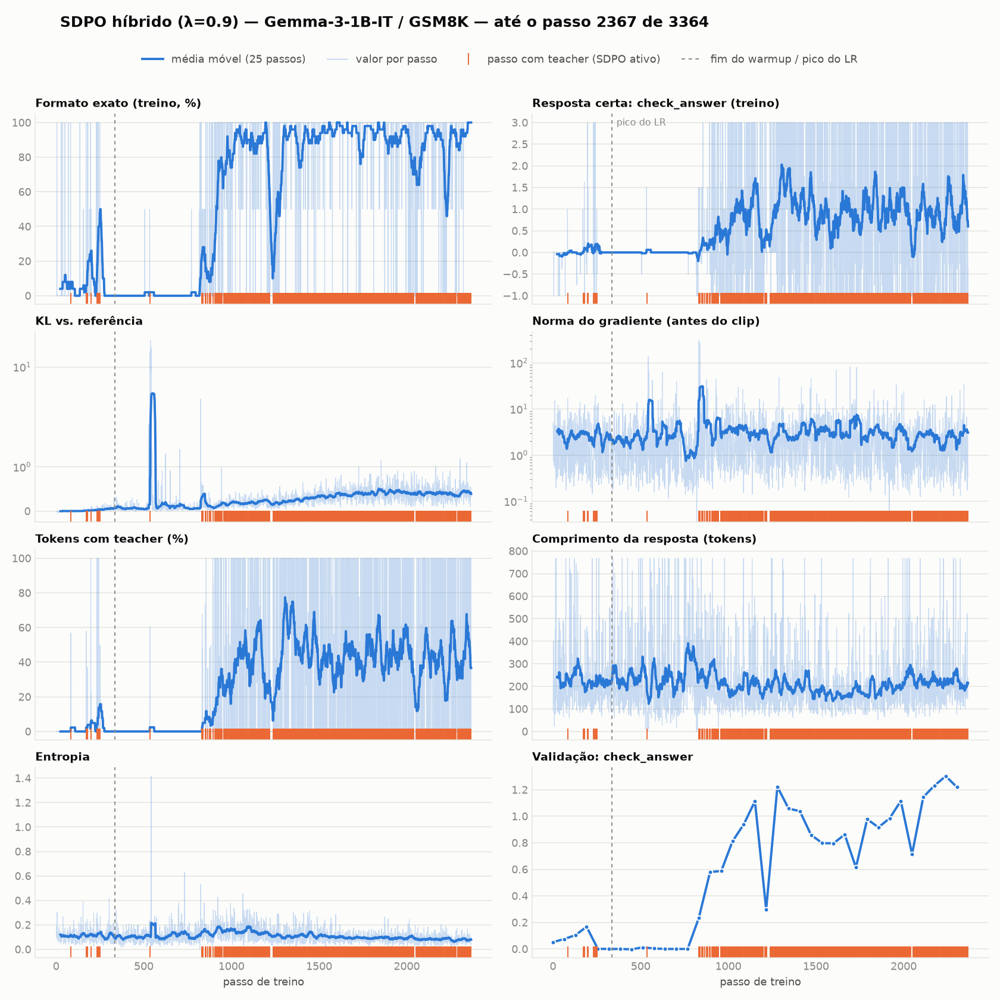

# SDPO híbrido (λ=0.9) — Gemma-3-1B-IT / GSM8K

Run de `../../sdpo_gemma.ipynb` em Colab TPU v5e-1, iniciado em 2026-10-28. Configuração:
- `GRPO_LAMBDA=0.9`, `DISTILL_MODE="token"`, sucesso = `check_answer == 3`
- G=2, LoRA r=64, LR 3e-6, β=0.08: o resto é igual ao run GRPO de `../../grpo_gemma.ipynb`

**Run incompleto.** O runtime do Colab foi reclamado por volta do passo 2369 de 3364. A avaliação final (greedy, 64 exemplos de teste) e os checkpoints LoRA estavam só na VM e se perderam. Aqui ficou o que já tinha sido baixado:

| arquivo | conteúdo |
|---|---|
| `tb/` | eventos do Tensorboard até o passo ~2367 |
| `sdpo_full.log.gz` | stdout do notebook. Os prints do `check_numbers` trazem pergunta, resposta e número extraído de cada rollout |
| `training_panel.png` | painel das métricas de treino, gerado por `plot_training.py` |
| `parse_rollouts.py` | acurácia e formato por rodada de validação, extraídos do log |

```bash
uvx --with tensorboard --with matplotlib --with numpy python plot_training.py
python3 parse_rollouts.py sdpo_full.log.gz ../../grpo_gemma.ipynb
```

## O que se observou



- **Passos 0 a 250:** o termo GRPO começa a ensinar o formato e chega a ~23% de formato exato no treino.
- **Passos 300 a 800:** o formato colapsa para 0%. No passo ~537 há um pico de KL de ~20, logo depois de um passo com teacher.
  - Ainda não se sabe se isso vem do modo `"token"` da destilação ou se é oscilação do GRPO no pico do LR, no passo 336.
  - Os passos com teacher têm gradiente de 10 a 300 de norma, contra 2 a 3 nos demais. O clip global é de 0.1.
- **Do passo ~800 em diante:** o formato volta e fica em ~90% a 100%. O SDPO passa a agir em quase todo passo, com 30% a 60% dos tokens tendo teacher.

### Validação

São rollouts amostrados com T=0.9, a 1ª resposta de cada grupo. A tabela usa as 323 perguntas que aparecem nos logs dos dois runs.

| | acerto | formato exato |
|---|---|---|
| antes de treinar (idêntico nos dois runs) | 50.5% | 6.2% |
| SDPO híbrido, 4 últimas rodadas (~2100 a 2300) | 55.0% | 92.9% |

O output do notebook GRPO foi truncado pelo Colab nas últimas 5000 linhas e não contém as rodadas de validação do fim do treino. Por isso **ainda não há comparação direta com o GRPO** no mesmo protocolo.

A única métrica do GRPO disponível é o teste greedy em 64 exemplos: 48.4% de acerto, 54.7% de acerto parcial e 82.8% de formato.

### Comparativo geral

Os protocolos são diferentes, então os valores absolutos não são comparáveis entre os dois runs. Cada run tem a própria baseline, medida no mesmo protocolo que ele. As duas baselines quase coincidem, e por isso o que se compara é o **ganho sobre a baseline** (Δ).

| | protocolo | acerto | Δ acerto | formato | Δ formato |
|---|---|---|---|---|---|
| baseline | teste, greedy, n=64 | 48.4% | — | 6.25% | — |
| GRPO (fim, passo 3364) | teste, greedy, n=64 | 48.4% | +0.0 | 82.8% | +76.6 |
| baseline | validação, amostrado T=0.9, n=323 | 50.5% | — | 6.2% | — |
| SDPO híbrido (passos ~2100 a 2300) | validação, amostrado T=0.9, n=323 | 55.0% | +4.5 | 92.9% | +86.7 |

Leitura: o SDPO híbrido aprende o formato pelo menos tão bem quanto o GRPO e mostra um ganho de acerto que o GRPO não teve. Isso é **indício, não conclusão**, por quatro motivos:
- O erro padrão do acerto é de ~±6 pp com n=64 e de ~±2.8 pp com n=323.
- Comparam-se greedy e amostragem.
- Comparam-se teste e validação.
- O run do SDPO não terminou.

## Próximos passos

1. Refazer o run:
   - copiar checkpoints, eventos e log para fora da VM durante o treino;
   - gravar a avaliação final num JSON.
2. Avaliar o GRPO (`gemma-3-1b-it-grpo-gsm8k`, no HF) e o SDPO no mesmo protocolo: greedy, test set inteiro do GSM8K (1319 exemplos).
3. Se o colapso se repetir, testar `DISTILL_MODE="topk"` (JSD limitada, como no paper) e um controle com λ=1.
