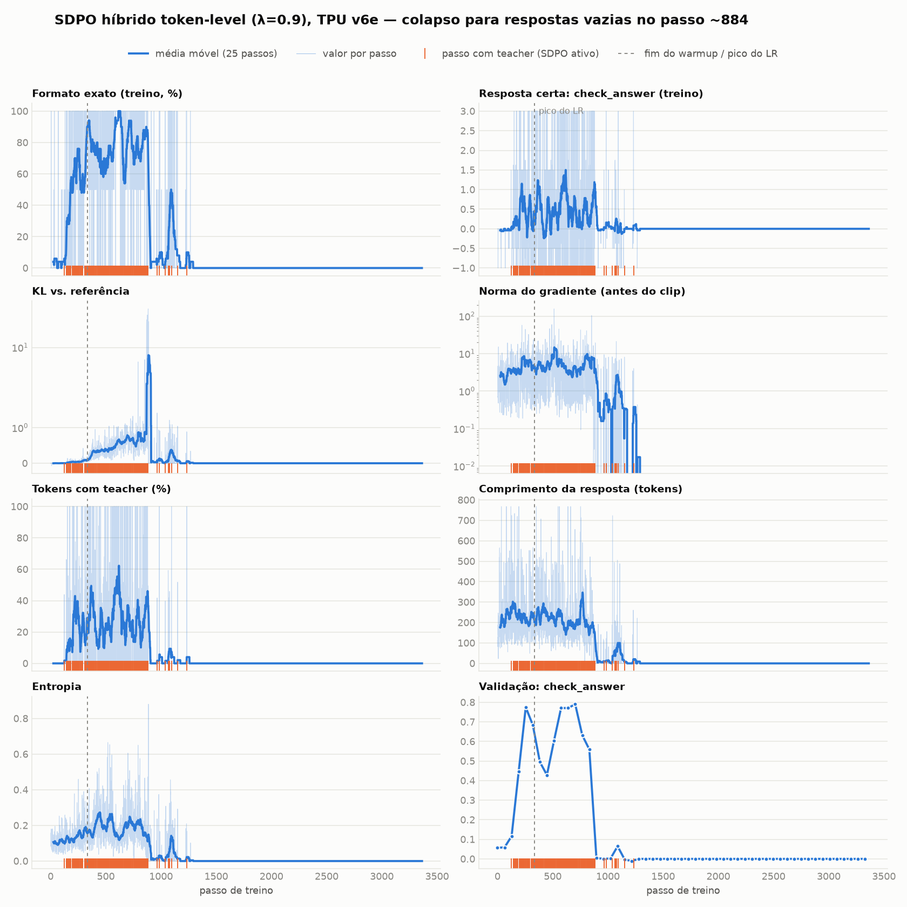

# SDPO híbrido token-level (λ=0.9), TPU v6e: colapso para respostas vazias

Run do `sdpo_gemma.ipynb` (versão do PR #9) numa TPU v6e-1 pelo Colab web, em 2026-10-29.
- Configuração: `GRPO_LAMBDA=0.9`, `DISTILL_MODE="token"`, G=2, LoRA r=64, LR 3e-6, β=0.08.
- Completou os 3364 passos em ~1h30.
- **O modelo final só gera respostas vazias**: 0% em tudo na avaliação final.



```bash
uvx --with tensorboard --with matplotlib --with numpy python plot_training.py
```

## O que aconteceu

| passos | KL vs ref | grad norm (mediana) | formato | comprimento | reward de validação |
|---|---|---|---|---|---|
| 0–100 | 0.00 | 1.3 | 3% | 213 | 0.3 |
| 200–400 | 0.05–0.20 | 2.7–3.9 | 61–81% | ~225 | 5.2–5.5 |
| 500–800 | 0.45–0.66 | 2.2–3.4 | ~80% | 240 → 180 | 4.5–5.6 (máx. no passo 576) |
| 800–880 | 2.35 | 1.5 (máx. 104) | 67% | 136 | 5.0 → −2.4 |
| 884 em diante | 0.00 | 0.00 | 0% | **0 tokens** | **−2.5** (vazio) |

**1. Deriva com o token-level.**
- `sdpo/distill_value = log π − log q` ficou **sempre positivo** (0.1 a 0.4). O teacher, com a demonstração no contexto, sempre dava menos probabilidade que o student aos tokens amostrados.
- O estimador de token amostrado, `sg(log π − log q)·∇log π`, vira então um *unlikelihood* sistemático. A massa sai dos tokens escritos e vai para qualquer outro, inclusive o EOS.
- O resultado foi a KL contra a referência subindo sem parar e as respostas encurtando.
- Nos passos com teacher, o grad norm mediano foi 6.0, contra 1.3 nos demais.

**2. Estado absorvente.**
- Desde o passo 884 as respostas têm **0 tokens**: o EOS não entra na completion, então a `completion_mask` é toda zero.
- Com isso a loss não tem nenhum token onde agir, nem GRPO, nem SDPO, nem KL, e o gradiente é exatamente 0.
- Com G=2, um grupo com as duas respostas vazias não dá sinal nenhum.
- As tentativas de recuperação (passos 912 e 1000–1100) morreram por volta do passo 1300.

**3. O resultado bom foi perdido.**
- A validação chegou a 5.6 de 10 entre os passos 320 e 576.
- A avaliação final só usava o checkpoint do `MAX_STEPS`, e o `MAX_TO_KEEP=4` já tinha apagado os checkpoints bons.

Havia ainda picos de gradiente em passos **sem** teacher (passo 512: 156; passo 851: 104). Isso sugere que o termo GRPO reimplementado também contribuía; ele era diferente da loss do Tunix usada no `grpo_gemma.ipynb`.

## Correções no notebook

1. **Logit-level SDPO como default** (`DISTILL_MODE="logit"`), como na Fig. 10 do paper: JSD α=0.5 sobre os top-K=100 do student mais a cauda.
   - A divergência é limitada por token (≤ ln 2) e também puxa para cima os tokens que o teacher prefere.
   - O token-level continua disponível, com `|log π − log q|` clipado em `distill_clip=5`.
2. **O termo GRPO agora é o `grpo_loss_fn` do próprio Tunix**, com clip PPO, `sequence-mean-token-mean` e β·KL. Com λ=1, a loss é idêntica à do GRPO de referência, no valor e no gradiente (testado).
3. **Guard contra o estado absorvente:**
   - novas métricas `sdpo/empty_completion_fraction` e `sdpo/all_empty_group_fraction`;
   - o treino para quando ≥90% das respostas vêm vazias na média de 50 passos. Neste run, teria parado no passo ~935.
4. **Seleção do checkpoint pela validação:**
   - os checkpoints são salvos a cada 256 passos, alinhados com a validação, e todos são mantidos;
   - a avaliação final usa o checkpoint de melhor reward de validação e também mostra o último.
   - Neste run, teria escolhido o passo 256 (validação 5.2) em vez do 3364 (−2.5).
