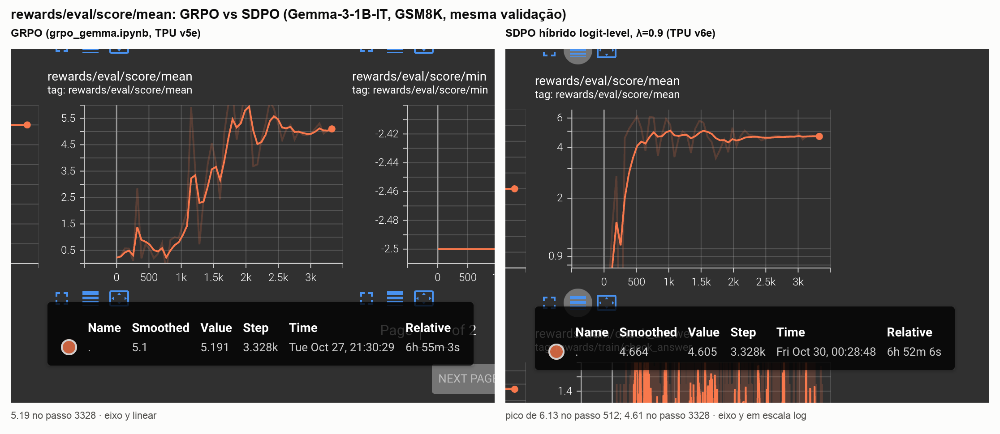
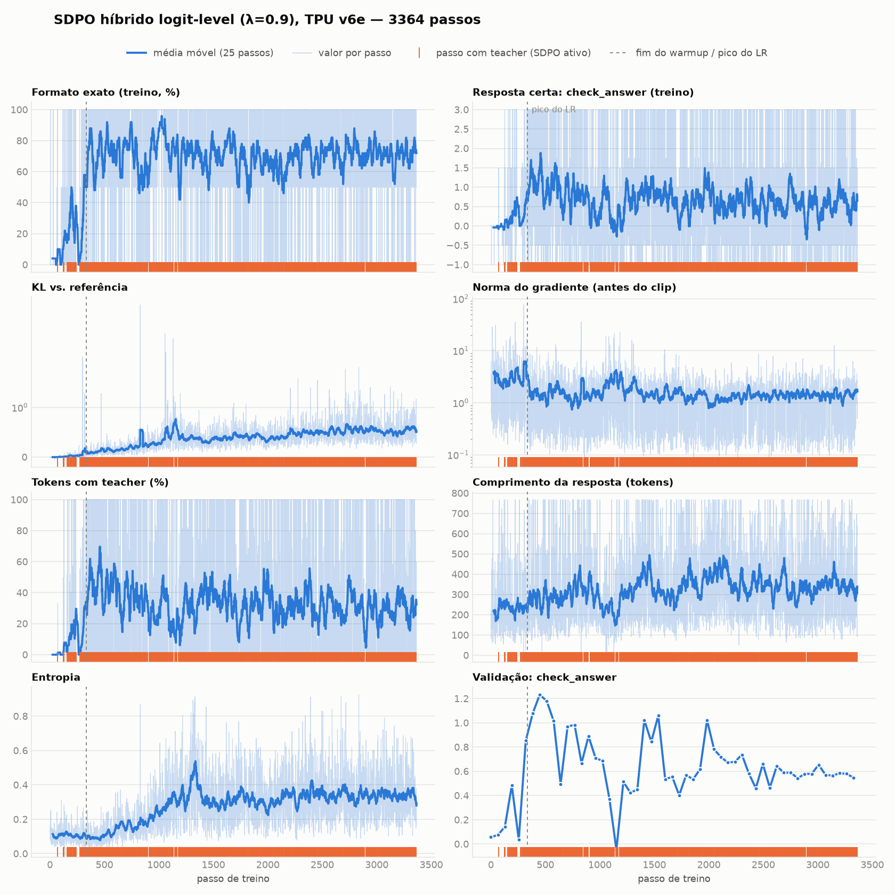

# SDPO híbrido logit-level (λ=0.9), TPU v6e

Run de `../../sdpo_gemma.ipynb` no commit `74fe621` (PR #10), numa TPU v6e-1 pelo Colab web, de 2026-10-29 a 2026-10-30.
- `DISTILL_MODE="logit"` (JSD α=0.5 sobre top-K=100 + cauda), `GRPO_LAMBDA=0.9`.
- O termo GRPO é o `grpo_loss_fn` do Tunix.
- G=2, LoRA r=64, LR 3e-6, β=0.08, 3364 passos: o resto é igual ao `grpo_gemma.ipynb`.

## Resultado

**O fix funcionou: o treino foi estável até o fim.**
- Nenhuma resposta vazia (`sdpo/empty_completion_fraction` = 0 o run todo).
- Norma do gradiente estável em ~1.5, sem os picos de 100+ do token-level.
- Formato exato no treino em ~70–80%.
- Compare com `../sdpo_hybrid_l09_v6e/`, que colapsou no passo 884.

**Convergência ~5× mais rápida em passos.** Valores de `rewards/eval/score/mean` (máx. 10), na mesma validação:

| limiar | GRPO (aprox., lido do Tensorboard) | SDPO logit | aceleração |
|---|---|---|---|
| ≥ 3 | ~1.5k | 320 | ~5× |
| ≥ 4 | ~1.8k | 320 | ~5–6× |
| ≥ 5 | ~2.0–2.1k | 384 | ~5× |
| pico | ~5.5–5.9 (~2.0–2.2k) | **6.13 (passo 512)** | ~4× antes |
| fim (passo 3328) | 5.19 | 4.61 | — |

- O GRPO fica ~1000 passos quase parado. Com G=2 e 6% de formato correto no modelo base, quase todo grupo tem vantagem zero.
- No SDPO, uma única resposta certa vira demonstração para o teacher, que ensina token a token, inclusive o formato.
- Isso é coerente com o paper, que reporta ~6× mais rápido.
- O tempo de relógio total foi parecido (~6h50 nos dois), mas em TPUs diferentes: v5e no GRPO, v6e no SDPO. O passo do SDPO custa mais, porque tem os forwards do teacher e do top-K.

**Mas o SDPO não termina melhor.**
- Depois do pico no passo 512, a validação cai e estabiliza em ~4.6–4.7.
- Ao mesmo tempo, a entropia sobe de 0.1 para ~0.35, o comprimento das respostas de ~220 para ~350 tokens, e a KL vai a ~0.6.
- No teste greedy (64 exemplos) aparecem **loops de repetição** até esgotar os 768 tokens. Um exemplo é "The number of eggs needed is 16." repetido.

| teste greedy, n=64 | acerto | parcial | formato |
|---|---|---|---|
| baseline | 48.4% | 50.0% | 6.25% |
| GRPO (fim) | 48.4% | 54.7% | 82.8% |
| SDPO logit λ=0.9 | 45.3% | 46.9% | 67.2% |

O erro padrão do acerto é de ~±6 pp, então a diferença de acerto é um empate estatístico; a de formato não é.

O print da avaliação final não mostra qual checkpoint foi avaliado. A célula avalia primeiro o melhor pela validação (o do passo 512) e depois o último (3364). Para fechar a comparação, avalie o checkpoint 512, que está salvo localmente em `ckpts/actor_512.tar`.

## Artefatos

| arquivo | conteúdo |
|---|---|
| `tb/` | eventos do Tensorboard completos (passos 0 a 3364) |
| `training_panel.png` / `plot_training.py` | painel de treino |
| `grpo_vs_sdpo_val_score.png` / `combine_screenshots.py` | prints do Tensorboard lado a lado (`tb_*_val_score.png`) |
| `ckpts/` (fora do git) | `model_params` LoRA dos passos 256, 512, 768 e 1024 |

Os checkpoints de 1280 a 3364, os outputs do notebook e a pasta exportada se perderam: o runtime foi encerrado às 00:42 do dia 30, uns 10 minutos depois da avaliação final.

**O upload para `rhd008/gemma-3-1b-it-sdpo-gsm8k` não foi verificado.** O repo é privado e o token só existia no kernel do navegador.

## Próximos passos

1. Avaliar o checkpoint 512 no teste greedy e, de preferência, no test set inteiro do GSM8K (1319 exemplos).
2. Para conter a degradação depois do pico:
   - early stopping pela validação;
   - λ menor ao longo do treino, ou desligar a destilação depois que o formato é aprendido;
   - um termo de penalidade de repetição ou de comprimento.
3. Seeds adicionais para os dois métodos.
