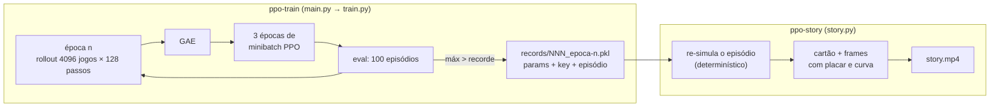
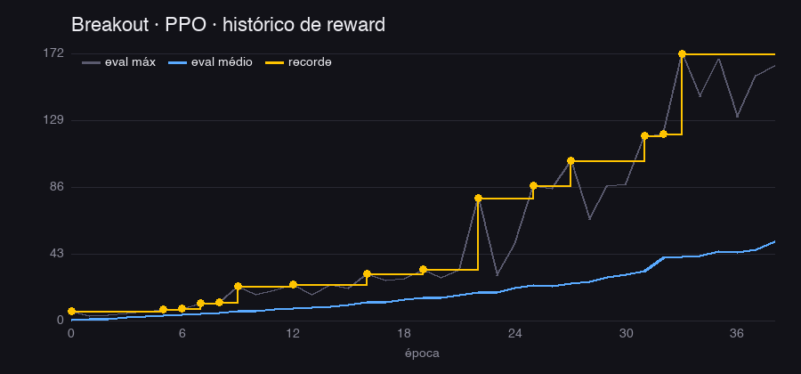
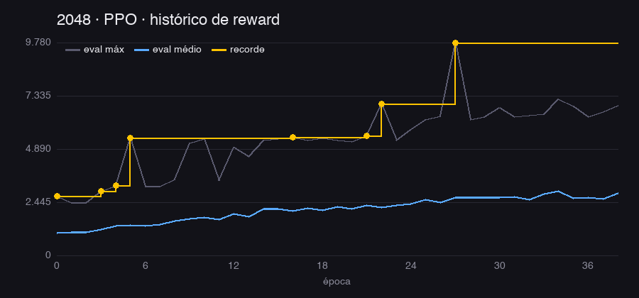

# PPO do zero — e o vídeo de cada recorde

Um PPO enxuto em **JAX + flax.nnx** sobre jogos do [pgx](https://github.com/sotetsuk/pgx), treinado
num Mac (Apple Silicon, backend MPS). A cada **novo recorde**, o treino guarda o episódio; no fim,
um script monta um **MP4** no estilo "treinando uma rede neural do zero", com a **trajetória
completa** de cada recorde e a época em que ele aconteceu.

Começa no **MinAtar Breakout**. Outros jogos single-player do pgx entram com uma linha em
`src/ppo/envs.py`: Freeway, Asterix, Seaquest, Space Invaders e 2048.

## Instalação

O projeto é um pacote uv (`src/ppo`) e membro do workspace da raiz do repo:

```sh
uv sync --package ppo        # na raiz do repo ou dentro de projects/2026/ppo
cd projects/2026/ppo         # os comandos abaixo gravam em ./runs
```

`uv sync` instala três comandos: `ppo-train`, `ppo-story` e `ppo-plot`.

## Treinar

```sh
uv run ppo-train                          # MinAtar Breakout, 20M passos, GPU (MPS)
uv run ppo-train env=2048 seed=1          # outro jogo / outra seed
uv run ppo-train env=minatar-freeway total_timesteps=5000000
uv run ppo-train platform=cpu num_envs=64 minibatch_size=1024 total_timesteps=50000   # teste rápido (~5 s)
```

- **Configuração:** os parâmetros vão como `chave=valor`. A lista completa, com os defaults do
  `pgx/examples/minatar-ppo`, está na classe `Config` em `src/ppo/main.py`.
- **Jogos:** `minatar-breakout`, `minatar-freeway`, `minatar-asterix`, `minatar-seaquest`,
  `minatar-space_invaders` e `2048`.
- **Saída:** cada treino grava em `runs/<jogo>-seed<k>/`, ou em `run_dir=...`:
  - `config.json`: a configuração usada, incluindo a plataforma, que o vídeo reutiliza;
  - `metrics.jsonl`: uma linha por época;
  - `records.jsonl` + `records/NNN_epoca-EEEE.pkl`: um checkpoint de replay por recorde;
  - um novo treino no mesmo diretório apaga os recordes anteriores.

## Gerar os vídeos

Depois do treino, sempre a partir dos `records/*.pkl` de um run:

```sh
uv run ppo-story runs/minatar-breakout-seed0                    # → runs/.../story.mp4
uv run ppo-story runs/2048-seed0 --fps 60 --max-clip-seconds 40 --out runs/2048-seed0/story_curto.mp4
uv run ppo-plot  runs/minatar-breakout-seed0 runs/2048-seed0    # → reward.png de cada run
```

| opção do `ppo-story` | efeito |
|---|---|
| `--out` | caminho do MP4 (padrão `<run>/story.mp4`) |
| `--fps` | quadros por segundo (padrão 30; 60 dobra a velocidade) |
| `--max-clip-seconds` | acelera episódios longos pulando frames, para cada clipe caber nesse tempo (padrão: episódio inteiro, sem pular) |
| `--card-seconds` | duração do cartão antes de cada recorde (padrão 1,5 s) |
| `--platform` | plataforma JAX da re-simulação (padrão: a do treino, em `config.json`) |

- O vídeo tem uma capa, depois um cartão e o episódio completo para cada recorde, e por fim a
  curva de aprendizado.
- Para cada recorde, o script re-simula o episódio e confere se o retorno bate com o salvo. Se não
  bater, por exemplo porque a plataforma é diferente da do treino, ele avisa.
- O `story_manifest.json` ao lado do MP4 lista os frames de cada clipe.
- MP4 e manifest não vão para o git.

## Testes

```sh
uv run pytest -q tests     # CPU, ~20 s
```

## Estrutura

```
ppo/
├── pyproject.toml         # pacote uv (uv_build) + scripts ppo-train / ppo-story / ppo-plot
├── src/ppo/
│   ├── main.py            # ppo-train: configuração (OmegaConf + pydantic) e preparação do run → train.train
│   ├── train.py           # o PPO: rollout → GAE → épocas de minibatch, tudo num único jax.jit
│   ├── agent.py           # rede ActorCritic (nnx), máscara de ações ilegais e passo de avaliação
│   ├── envs.py            # registro de jogos (id do pgx, título, reward_scale, tipo de render)
│   ├── recorder.py        # RecordKeeper: guarda o "checkpoint de replay" de cada recorde
│   ├── render.py          # re-simula um recorde e desenha os frames (960×540)
│   ├── story.py           # ppo-story: capa → [cartão + episódio completo] por recorde → curva final
│   └── plot.py            # ppo-plot: histórico de reward do run → reward.png
├── tests/test_ppo.py
└── runs/<jogo>-seed<k>/   # config.json, metrics.jsonl, records.jsonl, records/*.pkl, reward.png, story.mp4
```

## Como funciona



**PPO** (port do `pgx/examples/minatar-ppo`, derivado do PureJaxRL). Cada época faz quatro coisas:
1. joga 128 passos em 4096 ambientes paralelos com a política atual;
2. calcula vantagens com GAE (γ = 0.99, λ = 0.95);
3. faz 3 passadas de minibatch no objetivo *clipped* (ε = 0.2), com perda de valor e bônus de
   entropia;
4. tudo isso roda dentro de um único `jax.jit`.

**Recordes sem custo no treino.** Gravar frames durante o treino seria caro: 100 episódios de até
milhares de passos em cada avaliação. Como a avaliação é determinística dados `(params, key)`, o
`RecordKeeper` guarda só os parâmetros, a key e o índice do melhor episódio (~300 KB), e apenas
quando o recorde sobe. Depois do treino, o `ppo-story` **re-simula** cada episódio exatamente e
confere se o retorno bate com o salvo.

**Vídeo.**
- Os frames são gerados em streaming para o ffmpeg, que vem embutido no pip `imageio-ffmpeg`
  (sem `brew`).
- Cada clipe mostra **todos os passos** do episódio.
- Para vídeos mais curtos, `--max-clip-seconds 30` acelera episódios longos pulando frames, e
  `--fps 60` dobra a velocidade.

## Resultados

Seed 0, 20M passos (38 épocas de 524k passos) por jogo, Apple M5 (MPS), hiperparâmetros do
exemplo do pgx:

| jogo | eval médio final | referência | recordes | treino | vídeo (local) |
|---|---|---|---|---|---|
| Breakout | **50.7** | benchmark pgx ~50 | 15 (6 → 172) | 4.8 min | 7 min 17 s |
| 2048 | **2.847** (máx 6.896) | política aleatória ≈ 1.040 | 8 (2.728 → 9.780) | 1.6 min | 2 min |





- Em amarelo, o recorde (cada ponto é um clipe do vídeo); em azul, a média dos 100 episódios do
  eval; em cinza, o melhor episódio de cada eval.
- Os MP4 não vão para o git (`*.mp4` no `.gitignore`). Para gerá-los, veja [Gerar os vídeos](#gerar-os-vídeos). Cada clipe mostra o episódio **completo**, re-simulado com
  retorno idêntico ao salvo.
- No Breakout, os episódios dos recordes crescem de 74 para 2.882 passos. No 2048, de 219 para 569
  jogadas.

## Notas

- **MPS:** usa o [jax-mps](https://github.com/tillahoffmann/jax-mps) 0.10.x, compatível com o
  `jax==0.10.1` do repo. Use `platform=cpu` para rodar sem GPU.
- **Determinismo do replay:** o `ppo-story` usa a mesma plataforma do treino (gravada em
  `config.json`). Em outra plataforma, a re-simulação pode divergir; o script avisa quando isso
  acontece.
- **2048:** as ações ilegais são mascaradas na política, e `reward_scale = 0.01` porque os merges
  valem até milhares de pontos. O vídeo mostra a pontuação real.
