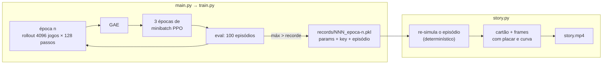

# PPO do zero — e o vídeo de cada recorde

Um PPO enxuto em **JAX + flax.nnx** sobre jogos do [pgx](https://github.com/sotetsuk/pgx), treinado
num Mac (Apple Silicon, backend MPS). A cada **novo recorde**, o treino guarda o episódio; no fim,
um script monta um **MP4** no estilo "treinando uma rede neural do zero", com a **trajetória
completa** de cada recorde e a época em que ele aconteceu.

Começa no **MinAtar Breakout**. Outros jogos single-player do pgx entram com uma linha em
`envs.py`: Freeway, Asterix, Seaquest, Space Invaders e 2048.

## Como rodar

```sh
# na raiz do repo (uv workspace)
uv sync --package ppo
cd projects/2026/ppo

uv run --package ppo python main.py                         # Breakout, 20M passos, MPS
uv run --package ppo python story.py runs/minatar-breakout-seed0   # → runs/.../story.mp4
uv run --package ppo python plot.py runs/minatar-breakout-seed0    # → runs/.../reward.png

uv run --package ppo python main.py env=2048 seed=1         # outro jogo
uv run --package ppo python main.py platform=cpu num_envs=64 total_timesteps=50000   # teste rápido
uv run --package ppo pytest -q tests
```

## Estrutura

```
ppo/
├── main.py       # configuração (OmegaConf + pydantic) e preparação do run → train.train(cfg)
├── train.py      # o PPO: rollout → GAE → épocas de minibatch, tudo num único jax.jit
├── agent.py      # rede ActorCritic (nnx), máscara de ações ilegais e passo de avaliação
├── envs.py       # registro de jogos (id do pgx, título, reward_scale, tipo de render)
├── recorder.py   # RecordKeeper: guarda o "checkpoint de replay" de cada recorde
├── render.py     # re-simula um recorde e desenha os frames (960×540)
├── story.py      # monta o MP4: capa → [cartão + episódio completo] por recorde → curva final
├── plot.py       # histórico de reward do run → reward.png
└── runs/<jogo>-seed<k>/   # config.json, metrics.jsonl, records.jsonl, records/*.pkl, reward.png, story.mp4
```

## Como funciona



**PPO** (port do `pgx/examples/minatar-ppo`, derivado do PureJaxRL). Cada época faz quatro coisas:
1. joga 128 passos em 4096 ambientes paralelos com a política atual;
2. calcula vantagens com GAE (γ = 0.99, λ = 0.95);
3. faz 3 passadas de minibatch no objetivo *clipped* (ε = 0.2), com perda de valor e bônus de
   entropia;
4. tudo isso roda dentro de um único `jax.jit`.

**Recordes sem custo no treino.** Gravar frames durante o treino seria caro: 100 episódios de até
milhares de passos em cada avaliação. Como a avaliação é determinística dados `(params, key)`, o
`RecordKeeper` guarda só os parâmetros, a key e o índice do melhor episódio (~300 KB), e apenas
quando o recorde sobe. Depois do treino, o `story.py` **re-simula** cada episódio exatamente e
confere se o retorno bate com o salvo.

**Vídeo.**
- Os frames são gerados em streaming para o ffmpeg, que vem embutido no pip `imageio-ffmpeg`
  (sem `brew`).
- Cada clipe mostra **todos os passos** do episódio.
- Para vídeos mais curtos, `--max-clip-seconds 30` acelera episódios longos pulando frames, e
  `--fps 60` dobra a velocidade.

## Resultados

Seed 0, 20M passos (38 épocas de 524k passos) por jogo, Apple M5 (MPS), hiperparâmetros do
exemplo do pgx:

| jogo | eval médio final | referência | recordes | treino | vídeo (local) |
|---|---|---|---|---|---|
| Breakout | **50.7** | benchmark pgx ~50 | 15 (6 → 172) | 4.8 min | 7 min 17 s |
| 2048 | **2.847** (máx 6.896) | política aleatória ≈ 1.040 | 8 (2.728 → 9.780) | 1.6 min | 2 min |


- Em amarelo, o recorde (cada ponto é um clipe do vídeo); em azul, a média dos 100 episódios do
  eval; em cinza, o melhor episódio de cada eval.
- Os MP4 não vão para o git (`*.mp4` no `.gitignore`). Para gerá-los, basta rodar o `story.py` com
  os `records/*.pkl` de um treino. Cada clipe mostra o episódio **completo**, re-simulado com
  retorno idêntico ao salvo.
- No Breakout, os episódios dos recordes crescem de 74 para 2.882 passos. No 2048, de 219 para 569
  jogadas.

## Notas

- **MPS:** usa o [jax-mps](https://github.com/tillahoffmann/jax-mps) 0.10.x, compatível com o
  `jax==0.10.1` do repo. Use `platform=cpu` para rodar sem GPU.
- **Determinismo do replay:** o `story.py` usa a mesma plataforma do treino (gravada em
  `config.json`). Em outra plataforma, a re-simulação pode divergir; o script avisa quando isso
  acontece.
- **2048:** as ações ilegais são mascaradas na política, e `reward_scale = 0.01` porque os merges
  valem até milhares de pontos. O vídeo mostra a pontuação real.
